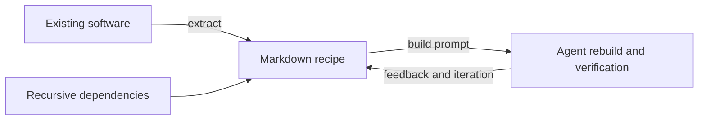
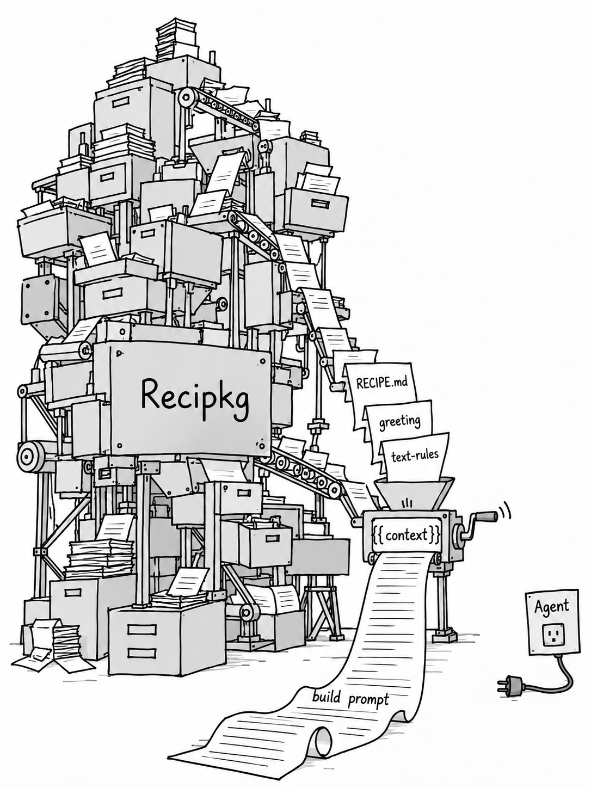

<p align="center">
  
</p>

<h1 align="center">Recipkg</h1>

<p align="center"><strong>Maintain the recipe. Let an agent rebuild the software.</strong></p>

<p align="center">
  <a href="README.md">中文</a> ·
  <a href="https://github.com/recipkg/standard-library">Standard library</a> ·
  <a href="docs/SPEC.en.md">Specification</a> ·
  <a href="docs/PHILOSOPHY.md">Philosophy</a> ·
  <a href="docs/SKILLS.md">Skill repositories</a>
</p>


From machine code to assembly to high-level languages, software has repeatedly packaged complexity into forms people can maintain. Recipkg explores another step: **keep behavior, constraints, dependencies, and acceptance criteria in an evolving recipe**. As models improve, an agent can use that same recipe to create a new implementation.

Recipes are Markdown. Recipkg organizes them, collects recursive dependencies, and renders a complete prompt. Your chosen agent observes, implements, and verifies the software. The CLI does not call a model or execute generated software; actual acceptance tests determine whether a recipe is sufficient.



**Start here:** [Install](#install) · [Try the example](#try-the-recursive-example) · [Five actions](#five-prompt-actions) · [Recipe format](#recipe-format) · [Skills](#skills) · [Development](#development)

## Why recipes?

Requirements, behavior, and acceptance criteria can outlast a particular implementation. Keep them with their dependencies, edit the prompts directly, reuse existing capabilities, and choose whether to evolve an implementation or rebuild it.

| Your goal | What Recipkg prepares |
| --- | --- |
| Understand and preserve software | A task to extract its behavior, dependencies, and acceptance criteria |
| Build or rewrite | A complete prompt with every recursive recipe |
| Share and reuse | Checkable Markdown recipe packages with pinned dependencies |
| Give an agent a project workflow | Project skills in independent repositories |

The standard library is extracting recipes from open-source projects across CLI, collaboration, communication, and agents. Each recipe records its evidence and gaps. [Browse the standard library →](https://github.com/recipkg/standard-library)

## Install

Python 3.11 or newer is required. The runtime uses the Python standard library; Git dependencies require the system Git executable.

Clone with `git clone --recurse-submodules https://github.com/recipkg/recipkg.git`. Recipes, specifications, and public skills are the primary input; the replaceable CLI source is pinned as the `generated/cli-source/` submodule from its own repository. Do not ignore `generated/`: the parent repository tracks the submodule pointers. Existing checkouts should run `git submodule update --init --recursive`.

From this checkout:

```sh
python3 -m venv .venv
. .venv/bin/activate
python3 -m pip install ./generated/cli-source
recipkg --help
```

For a user-global command, run `uv tool install ./generated/cli-source`. You can also install a distributed wheel. These instructions do not assume that the project has been published to a public package registry.

## Try the recursive example

The example contains three Markdown-only recipes: `hello` depends on `greeting`, which depends on `text-rules`.

```sh
recipkg check examples/hello
recipkg pack examples/hello -o hello-0.1.0.recipe.tar.gz
recipkg build hello-0.1.0.recipe.tar.gz --output hello-build.md
```

Give `hello-build.md` to your chosen agent. The prompt includes the root recipe and the full recursive dependency material, then asks the agent to implement and verify the software in a separate output directory. `--output` refuses to overwrite an existing file.

## Reconstruct Recipkg itself

`recipes/recipkg/` describes this tool, including its CLI contract, package format, acceptance criteria, English/Chinese templates, and three bundled skills.

```sh
recipkg pack recipes/recipkg -o recipkg-0.1.0.recipe.tar.gz
recipkg build recipkg-0.1.0.recipe.tar.gz --output recipkg-build.md
```

Give the resulting prompt to an agent to request a new implementation. This repository's first reference CLI uses Python; the recipe permits other implementation languages. A reconstruction still needs to pass actual acceptance checks.

## Five prompt actions

| Command | Task described by the generated prompt |
| --- | --- |
| `recipkg extract <software>` | Inspect existing software and write a complete recipe |
| `recipkg build <package>` | Implement and verify software from a recipe and its dependencies |
| `recipkg rewrite <package> --request "requirements"` | Update the recipe, then generate a fresh implementation |
| `recipkg add <package> <source> --alias <name>` | Verify and integrate a dependency into the recipe |
| `recipkg discover <package>` | Identify dependencies, missing specifications, and external requirements |

All five accept `--request`, `--output` / `-o`, and `--template`. By default stdout contains only the prompt; diagnostics go to stderr. `add` does not modify the manifest, and `extract` does not fetch or inspect the target itself.

Except for `extract`, targets can be local recipe directories, archives, or installed `name@version` references. An unversioned name is accepted only when exactly one version is installed. Use `pack` or `install` first when dependencies need fetching.

Prompts carry a `recipkg-prompt/1` marker and an action name. Custom Markdown templates accept `{{target}}`, `{{request}}`, `{{source}}`, `{{alias}}`, and `{{context}}`. Package action templates must include `{{context}}` to preserve the dependency material.

## Recipe format

`recipkg init my-app --name my-app` creates `RECIPE.md`, `BUILD_PROMPT.md`, `ACCEPTANCE.md`, and `AGENTS.md`. The manifest is the single TOML code fence inside `RECIPE.md`:

```toml
format = "recipkg/1"

[package]
name = "my-app"
version = "0.1.0"
kind = "software"
description = "The software's purpose and observable behavior"
entry = "BUILD_PROMPT.md"

[dependencies.greeting]
source = "../greeting"
```

Describe behavior, interfaces, constraints, and environment requirements in the entry document. Define observable acceptance criteria in `ACCEPTANCE.md`. A generated scaffold still needs substantive specifications before it can support reconstruction.

Dependencies may use relative paths, HTTPS recipe archives, or Git repositories pinned to full 40-character commit hashes. A Git `subdir` selects a recipe directory. A source-only repository or ordinary prompt document must first be converted into a Recipkg recipe. A dependency does not need to be a Git submodule: `recipkg pack` collects its recursive Markdown content from the pinned source and records it in the lock file. The root build prompt must still state each dependency alias's role, scope, and acceptance contract. See the [format specification](docs/SPEC.md).

For example, a recipe in the same workspace can depend on the shared quality recipe:

```toml
[dependencies.quality]
source = "../software-quality"
```

For an independent repository, use `git`, a reviewed full commit hash in `rev`, and `subdir`. Then describe in the root `BUILD_PROMPT.md` where the `quality` contract applies and how to verify it. `recipkg pack` vendors the dependency under `.deps/quality/`, so consumers receive the full Markdown context. Use a Git submodule only when developers need both repositories checked out together.

## Search for recipes

GitHub repositories publishing Recipkg recipes must have the `recipkg` topic. Preserve other topics when adding it:

```sh
gh repo edit owner/repo --add-topic recipkg
recipkg search
recipkg search "quality" --limit 10
recipkg search "quality" --json
```

`search` explicitly queries public GitHub repositories using `topic:recipkg`. Optional `GH_TOKEN` or `GITHUB_TOKEN` authentication can increase the request allowance. Keywords are literal text; `--limit` accepts 1–100, default 20. JSON output is an array containing `repository`, `url`, `description`, and `default_branch`; diagnostics and incomplete-result warnings go to stderr. A topic is neither package validation nor an endorsement: inspect the actual `RECIPE.md`, recipe subdirectory, license, and version before pinning a reviewed full commit. Search does not download implementations, install recipes, or execute content. Empty results succeed; network failures are explicit errors.

## Languages

All five prompt actions default to English; use `--lang zh-CN` for Simplified Chinese or `--lang en` explicitly:

```sh
recipkg build recipes/recipkg --lang en
recipkg build recipes/recipkg --lang zh-CN
```

Language selection changes the task template only. Root and dependency recipes, user requirements, and custom templates remain verbatim; locked materials are never automatically translated. CLI help, diagnostics, and protocol identifiers use English. Public skills provide English entry points and Chinese translations. Read the [English specification](docs/SPEC.en.md) for the package contract.

## Package operations

```sh
recipkg init my-app --name my-app
recipkg check my-app
recipkg pack my-app -o my-app-0.1.0.recipe.tar.gz
recipkg unpack my-app-0.1.0.recipe.tar.gz unpacked-app
recipkg install my-app-0.1.0.recipe.tar.gz
recipkg list
recipkg build my-app@0.1.0 --output my-app-build.md
recipkg remove my-app@0.1.0
```

`pack` recursively copies dependencies under `.deps/<alias>/`, rewrites their sources to archive-local paths, and generates a root `LOCK.md` containing SHA-256 file digests and source records. The archive no longer depends on the original local directories. Missing dependencies, cycles, invalid files, and integrity mismatches produce errors rather than silently incomplete context.

The default store is `$XDG_DATA_HOME/recipkg`, falling back to `~/.local/share/recipkg`. Override it with `RECIPKG_HOME` or a global `--home <directory>` before the subcommand, for example `recipkg --home ./store list`. Installation stores and validates recipes without executing their instructions.

## Skills

Three public skills ship with the CLI, with English entry points and `SKILL.zh-CN.md` translations:

| Skill | Purpose |
| --- | --- |
| `migrate-to-recipkg` | Initialize Recipkg in an existing project and extract a complete recursive recipe |
| `rewrite-to-recipkg` | Observe, specify, establish a recipe repository, rebuild, and verify |
| `test-feedback` | Run target-user end-to-end tasks and synthesize requirements from real tests and related issues |

All 11 project skills have independent canonical GitHub repositories pinned as submodules: three public skills under `recipes/recipkg/skills/`, and eight development skills under `.agents/skills/`. Migrated projects must reuse the same repositories as skill submodules instead of copying text. Development skills are not CLI builtins. See the [repository catalog](docs/SKILLS.md).

`skills sync` remains a managed-copy option for non-Git destinations; it does not create or replace project skill submodules.

```sh
recipkg skills list
recipkg skills sync --dest /path/to/your-agent/skills
```

Synchronization includes built-in skills, installed skill packages, and skills embedded in installed packages as `skills/<name>/SKILL.md`. Choose a directory supported by your agent. Only managed files are synchronized; repeated runs are idempotent, and local edits or conflicting files are not overwritten.

The CLI also manages complete project skills as pinned submodules. Point `--project` at the Git root, or omit it for the current directory:

```sh
recipkg skills project add https://github.com/recipkg/migrate-to-recipkg.git --name migrate-to-recipkg --rev <full-commit> --project /path/to/project
recipkg skills project list --project /path/to/project
recipkg skills project update migrate-to-recipkg --rev <full-commit> --project /path/to/project
```

Replace the example revision with a reviewed full commit. Add and update stage the gitlink for review and commit; they refuse dirty submodules and checked-out local branches. Skill submodules are not included in Markdown recipe archives, and their scripts are not executed.

Create a skill recipe with `recipkg init my-skill --name my-skill --kind skill`. Its manifest uses `kind = "skill"` and `entry = "SKILL.md"`. Standard YAML `name` and `description` frontmatter remains in `SKILL.md`; TOML configures the package, not the skill format.

## What “zero code” means

Every archive payload file is UTF-8 Markdown with a `.md` suffix. Recipe packages do not carry implementation source files, binaries, filesystem links, or executable hooks. The manager and generated software can contain code. The package protocol is independent of their implementation language or model provider.

Markdown may contain declarative configuration, interface descriptions, and input/output examples. File validation cannot prove that arbitrary natural-language content is sufficient for reconstruction, or that code has not been disguised as prose.

<p align="center">
  
</p>

## Development

```sh
RECIPKG_RECIPE_ROOT="$PWD" PYTHONPATH=generated/cli-source/src python3 -m unittest discover -s generated/cli-source/tests -v
```

Read [AGENTS.md](AGENTS.md) before contributing. Keep the format specification, examples, and observable CLI behavior aligned.

## License

[MIT](LICENSE). Copyright © 2026 LIghtJUNction.
